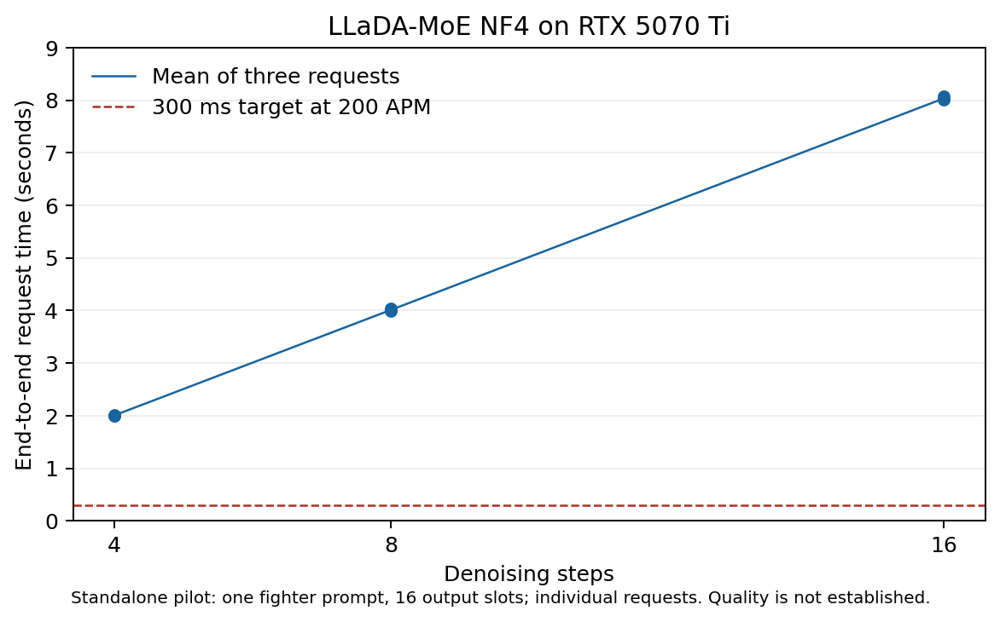

# Diffusion implementation and CUDA validation results

Date: 23 November 2026.

The first implementation milestone is complete: a checked CUDA LLaDA-MoE runtime,
correct output/timing accounting, responsive cooperative controls, reproducible
standalone measurements, and an orchestrated game co-location smoke test. The
remaining goal is a game-controlled admission bridge with useful compute chunks,
followed by a quality-controlled AR/diffusion benchmark. No scheduled dLLM or FPS
advantage is claimed by this milestone.

## Implementation

The runtime pins model, tokenizer, and remote code to revision
`783d3467f108d28ac0a78d3e41af16ab05cabd8d`. All three weight-shard SHA256 digests
match the pinned publisher metadata. The loader requires the exact `<|mask|>`
entry, ID 156895, complete checkpoint loading, actual NF4 quantization, and all
parameters on the one target GPU. It records 3,152 quantized linear modules.

Generation uses the publisher's single-block, temperature-zero, low-confidence
transfer schedule and the pinned instruction template. Budgets larger than the
canvas are rejected. Actual visible output IDs, requested positions, transfers,
real step durations, stop reason, and unresolved masks remain distinct fields.
The HTTP compatibility fields no longer treat the first diffusion pass as AR
prefill, double-count one-step duration, or report the output budget as actual
generated length. The analyzer explicitly separates diffusion generation from
autoregressive decode.

Only one request owns mutable model state. Health and manual pause/resume/stop
remain responsive through independent request threads. Acknowledged pauses occur
after the worker synchronizes its CUDA work, and controls do not preempt an
executing kernel. Temporary layer/config changes restore on exceptions.

The earlier Windows fence correction, render notifications, capture validation,
and diagnostic tools were brought into the maintained checkout. The corrected
Unreal package rebuilt successfully. The external trial runner anchors requests
to the game's QPC start, verifies rendering covers the drain, retains an offered
arrival ledger, and recrops frames to the inference window. Capture validity and
foreground eligibility are separate from successful execution.

## Correctness evidence

On the RTX 5070 Ti, the checked sampler matched full publisher output canvases
on three prompts at each of 4, 8, and 16 steps, with 16 output positions. The
reference is the actual publisher code extracted from a checksum-verified README,
not a second call to the same adapter. An acknowledged hold froze progress, resume
preserved output IDs, stop while paused completed cleanly, and a subsequent request
recovered. These are tested cases, not a proof for arbitrary shapes or models.
Both samplers use the same NF4 model instance. These checks validate the adapter;
they do not establish NF4-versus-BF16 quality equivalence.

A fresh native AR verification also passed mid-decode holds and exact output-ID
comparison. Eleven diffusion tests, 21 JavaScript tests, and two Python trace tests
pass. The diffusion suite includes numerical synthetic fixtures and live stub HTTP
tests; those tests are not model performance data.

The raw evidence includes failed attempts. A fresh-process CUDA initialization
error and an incorrect initial assertion about the adjacent `[gMASK]` token were
corrected before successful validation. The original HTTP download stalled; a
resumable Xet retry completed and the resulting weight hashes were checked.

## Standalone results

The clean-source pilot at commit `7a35ac2` used Python 3.12.10,
PyTorch 2.7.1+cu128, CUDA 12.8, Transformers 4.53.2, Accelerate 1.10.1,
bitsandbytes 0.48.2, NF4 weights with BF16 compute, and full noncausal SDPA
attention. It measured one fighter prompt, 16 requested output positions, full
depth, one warmup per configuration, and three requests per step budget. All
three repetitions returned the same full canvas IDs within each configuration.
It used `max_split_size_mb:128` after the memory investigation below.

| Steps | Mean request ms | Minimum ms | Maximum ms | Actual visible output tokens |
| --- | ---: | ---: | ---: | ---: |
| 4 | 2,006.99 | 1,998.87 | 2,016.73 | 14 |
| 8 | 4,011.78 | 3,987.27 | 4,036.52 | 14 |
| 16 | 8,034.89 | 8,006.39 | 8,073.34 | 14 |

The [portable numeric record](results/dllm_cuda_validation_2026-11-23.json)
includes individual samples, source hashes, weight digests, reference/control
checks, actual memory counters, and the earlier default-allocator pilot.

These are standalone request timings, not achieved paced APM or a matched AR
comparison. Three samples and one prompt do not establish p99 behavior,
statistical significance, or general game quality. In particular, the four-step
output began `Iodge`; the other outputs expressed an attack choice, but no semantic
game-state rubric was applied. A fast response cannot be counted as a successful
game action without that quality evaluation.

The roughly 500 ms whole denoising passes do not fit ordinary 60 FPS rendering
headroom, whose entire frame period is about 16.67 ms. The present Python eager
MoE path also misses the 300 ms target for 200 APM even without rendering. A
useful scheduler therefore needs backend optimization and smaller verified chunks,
or a different measured model/quality/demand point. These results do not isolate
diffusion architecture from implementation and quantization effects.

## Memory findings

Live loaded allocation was about 4.72 GiB; steady request peak allocation was
about 4.77 GiB. Initial allocator reservation was roughly 10.14 GiB. Calling
`empty_cache` did not reduce that reservation, so allocation alone would have
understated the memory footprint relevant to a game.

A bounded test of `max_split_size_mb:128` reduced post-load reservation to about
4.75 GiB and post-generation reservation to about 4.80 GiB while preserving the
validated four-step output canvas. The full clean batch then passed all nine
publisher comparisons, pause/stop/recovery, and nine repeated timing samples with
this configuration. Its canvases match the earlier allocator pilot. The actual
allocator setting is recorded and existing user overrides are preserved.
Framework reservation is distinct
from physical residency and total-device GPU counters.

The earlier default-allocator clean pilot at `6c63167` averaged 2.010 / 4.022 /
8.135 seconds. These sequential pilot batches establish memory accounting and
observed output preservation, not a statistical latency improvement from allocator
tuning. Loading can temporarily reserve more than the eventual steady state;
the orchestrator loads the model before launching the game.

## Game co-location evidence and capture requirement

The real packaged game and diffusion server completed two requests in a six-second
arrival window at 20 APM, with no skips or completed-request deadline misses.
The game covered the entire inference QPC interval and all owned processes shut
down. Coarse device sampling observed about 12,921 MiB peak use in this smoke
before the allocator change, leaving about 3,382 MiB free. That establishes fit
for this light scene and configuration only.

The smoke used `-SkipPresentMon` and its foreground samples were ineligible for
comparison. It supplies no FPS, frame-tail, quality-qualified throughput, or
co-scheduling result. No performance claim should be made from its two requests.

Windows ETW capture requires Administrator PowerShell; the available execution
profile is not elevated. The prepared local helper
`local/run-dllm-admin-capture.ps1` starts each owned model server in turn, records
model-only controls, runs repeated aligned unrestricted game trials, captures a
render-only control, and builds paired reports. It refuses an incomplete clean
validation batch and existing output directories. Keep every game window focused
and unobscured through warmup and capture. Its short fixed-order batch is still
preliminary; it is not the final paper matrix.

## Next steps toward the paper

1. Complete and inspect the Administrator frame-capture batch. Retain failed or
   background trials as excluded evidence. Verify exact coverage, focus lead-in,
   memory counters, actual output IDs, and both per-model baselines.
2. Profile the eager MoE implementation to identify launch, synchronization,
   routing, and compute costs. Evaluate an optimized backend on this exact GPU;
   do not transfer multi-GPU throughput claims to this one-GPU experiment.
3. Build the renderer-to-worker admission protocol with independent cancellation,
   process-death handling, sequenced acknowledgements, and bounded waits. Prove
   pause/output equivalence at the actual chosen chunk boundaries. Manual control
   correctness is only a prerequisite.
4. Measure whether practical layer/sublayer chunks fit observed rendering gaps.
   Compare against unrestricted execution with the same chunk/checkpoint costs.
   An oversized executing kernel cannot be repaired by a host gate after it.
5. Freeze a varied game-state quality set and explicit acceptance rubric. Complete
   skip-budget/quality experiments before adaptive skipping or adaptor claims.
   Use quality-qualified on-time APM alongside all offered arrivals and failures.
6. Run longer counterbalanced repetitions with heavier deterministic scenes and
   demand sweeps, comparing AR and diffusion sequentially on the same GPU. Record
   backend/quantization differences as confounders and publish run-level variation.

The detailed source map is in the original status report. The maintained
[implementation log](IMPLEMENTATION_LOG.md) and
[experiment protocol](EXPERIMENT_PROTOCOL.md) define the continuation requirements.
